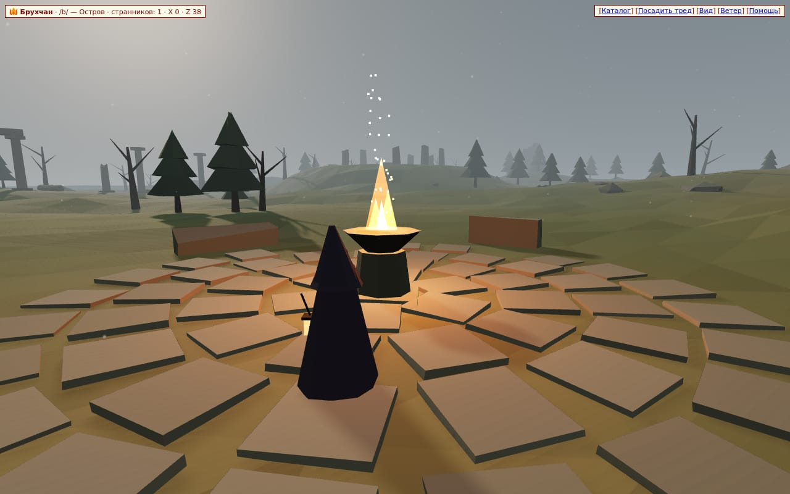
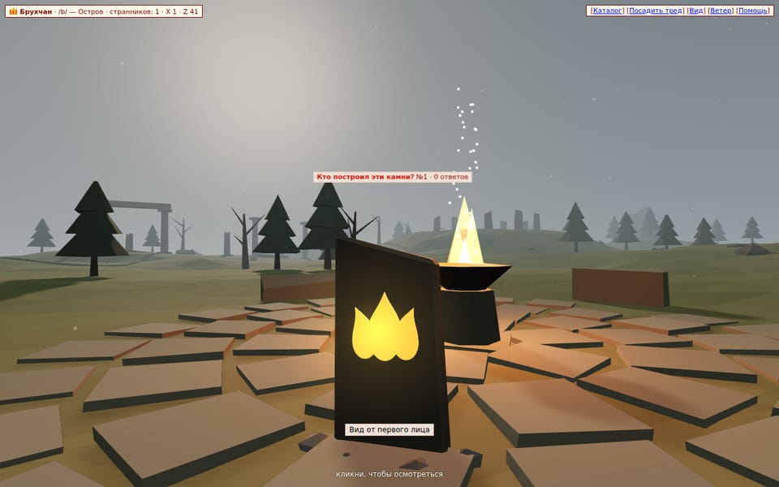
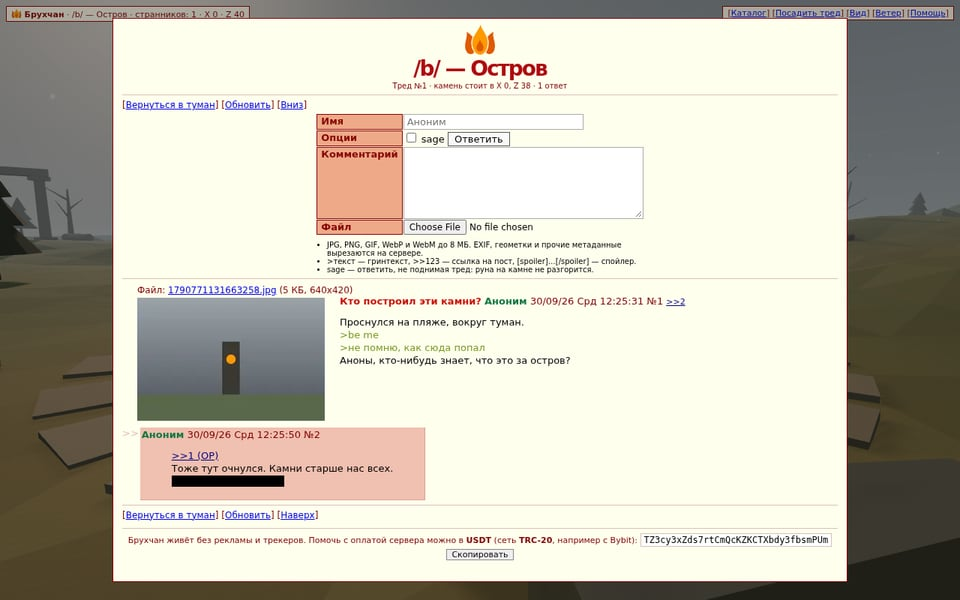

<div align="center">
  
  <h1>Брухчан</h1>
  <p><i>имиджборда, у которой вместо ленты — остров</i></p>
</div>

Брухчан — самохостящаяся пространственная 3D-имиджборда. Ты появляешься анонимным странником на туманном острове с руинами. Треды здесь — каменные монолиты, вкопанные в землю там, где стоял их автор. Подходишь к камню, жмёшь <kbd>E</kbd> — и получаешь честный тред в духе Yotsuba: картинки, webm, гринтекст, ответы. Хочешь сказать своё — встаёшь где нравится и сажаешь тред прямо под ногами.



| Камень с руной | Тред у камня |
| --- | --- |
|  |  |

## Что внутри

- **Остров из Blender.** Рельеф, каменный круг, колоннада, ворота на обрыве, разрушенная башня, лестница в никуда, жаровня на спавне, сосны, мёртвые деревья, валуны, скала в море. Всё собирается одним детерминированным скриптом `blender/build_world.py` в `world.glb`, `marker.glb`, `wanderer.glb` и `world.json` (карта высот и коллайдеры).
- **Треды как монолиты.** Координаты `(x, y, z)` лежат в SQLite. Высоту `y` сервер считает сам по той же карте высот, что и клиент, — координату от клиента он не принимает. Нельзя посадить тред в воду, внутрь руин или вплотную к другому камню (2,4 м).
- **Руна горит, пока тред живой.** Свежий бамп — яркое пульсирующее пламя, дальше руна остывает примерно за полчаса. `sage` отвечает без бампа.
- **Тред в духе 2000-х.** Таблица формы, `>гринтекст`, `>>ссылки` с превью при наведении, бэклинки, `(OP)`, `[spoiler]`, разворот картинок и webm по клику. Рамки в 1px, никаких скруглений. Весь интерфейс по-русски.
- **Мультиплеер.** Другие странники видны полупрозрачными фантомами (Socket.io, 10 снимков в секунду). Новые камни поднимаются из земли у всех в реальном времени.
- **Каталог острова** (<kbd>C</kbd>) показывает расстояние и направление до каждого камня и ставит столб света над выбранным. Читать тред можно только у самого камня.
- **Ветер** синтезируется в WebAudio. Никаких звуковых файлов и сторонних запросов.

## Анонимность — что гарантирует код

- **Ничего не спрашиваем и ничего не ставим.** Нет регистрации, паролей, почты. Нет кук: Express их не ставит, Socket.io запущен с `cookie: false`. `localStorage` не используется.
- **IP-адреса не читаются и не пишутся.** Нет логгера запросов, `trust proxy` выключен, в схеме БД нет полей под IP, user-agent или сессии. Тест `server code never reads client addresses` падает, если в `server/` появится `req.ip`, `x-forwarded-for`, `remoteAddress` и т. п.
- **Картинки чистятся в памяти.** sharp перекодирует каждую картинку прямо в памяти, поэтому EXIF, GPS, XMP, IPTC, ICC и комментарии исчезают *до* записи на диск. Ориентация запекается в пиксели. Исходное имя файла (`IMG_20260930_…`) не сохраняется.
- **WebM тоже.** WebM ремультиплексируется через `ffmpeg` по пайпам, без перекодирования. Вырезаются теги контейнера и потоков, главы, вложения и строка энкодера.
- **Ноль сторонних запросов.** three.js и клиент socket.io отдаются этим же сервером. CSP `default-src 'self'` с хэшем единственного inline-скрипта (import map). Дополнительно заданы `Referrer-Policy: no-referrer`, `Permissions-Policy`, `X-Frame-Options: DENY`.
- **Флуд-лимит глобальный**, token bucket, по умолчанию 30 постов в минуту на весь остров. Он намеренно не привязан к IP. Цена такого решения: один упорный спамер может временно занять лимит.

Что остаётся на совести того, кто хостит: логи обратного прокси, TLS и сам хостинг. Пример для nginx:

```nginx
server {
    listen 443 ssl;
    server_name bruhchan.example;
    access_log off;                 # никаких IP в логах прокси
    error_log /dev/null crit;
    client_max_body_size 9m;
    location / {
        proxy_pass http://127.0.0.1:3000;
        proxy_http_version 1.1;
        proxy_set_header Upgrade $http_upgrade;   # WebSocket для Socket.io
        proxy_set_header Connection "upgrade";
        proxy_set_header Host $host;               # X-Forwarded-For намеренно не передаём
    }
}
```

## Запуск

Нужен Node.js ≥ 20.17 (проверено на 24). Для приёма WebM нужен `ffmpeg`. Без него картинки работают, а WebM сервер вежливо отклоняет.

```sh
cd bruhchan
npm ci
npm start            # http://localhost:3000
```

Docker (образ `node:24-bookworm-slim` + ffmpeg; процесс без root, корневая ФС только для чтения, данные в томе `/data`):

```sh
cd bruhchan
docker compose up -d --build
```

| Переменная | По умолчанию | Смысл |
| --- | --- | --- |
| `PORT` / `HOST` | `3000` / `0.0.0.0` | где слушать |
| `DATA_DIR` | `./data` | SQLite и загруженные файлы (`src/`, `thumb/`) |
| `POSTS_PER_MINUTE` | `30` | глобальный флуд-лимит |
| `FFMPEG_PATH` | `ffmpeg` | путь к ffmpeg |

## Управление

| Клавиша | Действие | Клавиша | Действие |
| --- | --- | --- | --- |
| <kbd>W A S D</kbd> | идти | <kbd>E</kbd> | прочесть тред у камня |
| <kbd>Shift</kbd> | бежать | <kbd>T</kbd> | посадить тред здесь |
| <kbd>Пробел</kbd> | прыжок | <kbd>C</kbd> | каталог острова |
| мышь | осмотреться (pointer lock или перетаскивание) | <kbd>V</kbd> | вид от первого / третьего лица |
| <kbd>Esc</kbd> | отпустить мышь / закрыть тред | <kbd>M</kbd> | ветер вкл/выкл |

## Устройство

```
bruhchan/
├── blender/build_world.py   процедурный остров и пропсы → public/assets/*
├── server/
│   ├── app.js               Express 5 + Socket.io: API, заголовки, присутствие игроков
│   ├── db.js                better-sqlite3: posts, threads (x, y, z, heading, bump)
│   ├── media.js             sharp / ffmpeg: очистка метаданных в памяти, превью
│   └── limits.js            глобальный token bucket
├── public/
│   ├── index.html           портал в стиле главной 4chan + HUD
│   ├── css/board.css        палитра Yotsuba
│   ├── js/                  three.js-мир, игрок, камни, фантомы, тред-оверлей
│   │   └── terrain.js       карта высот и правила посадки — общий модуль клиента и сервера
│   └── assets/              world.glb, marker.glb, wanderer.glb, world.json
└── test/                    API и приватность (node:test) + e2e в Chromium
```

Клиент — чистые ES-модули через import map, без сборщика. three.js r186 отдаётся из `node_modules`.

## Остров из Blender

```sh
blender -b --factory-startup -P blender/build_world.py -- --out public/assets [--seed 1337] [--preview /tmp/preview.png]
```

Проверено на Blender 5.2.2 LTS. Один и тот же `--seed` всегда даёт один и тот же остров, поэтому `world.json`, которым пользуется сервер, точно совпадает с отрисованным рельефом (одинаковая триангуляция сетки на обеих сторонах). В живой сессии Blender (например через MCP) задай `BRUHCHAN_OUT = "путь/к/assets"` и выполни файл через `exec`: скрипт работает в своих коллекциях `bruhchan_*` и не трогает остальную сцену.

## Тесты

```sh
npm test       # 13 тестов: CSP и отсутствие кук, EXIF/GPS, теги WebM, правила посадки, bump/sage, сокеты, схема БД
npm run e2e    # настоящий Chromium (программный WebGL): портал → мир → посадить → прочесть → ответить → фантом → каталог
```

Для `e2e` нужен Chrome или Chromium: путь определяется сам или задаётся через `CHROME_PATH`. Скриншоты сохраняются в `test/e2e/out/`.

## API

| Метод | Путь | Тело |
| --- | --- | --- |
| `GET` | `/api/threads` | → `{ threads: [камни], stats: { threads, posts } }` |
| `GET` | `/api/threads/:id` | → `{ thread, posts }` |
| `POST` | `/api/threads` | multipart: `x`, `z`, `heading`, `name`, `subject`, `comment`, `file` |
| `POST` | `/api/threads/:id/replies` | multipart: `name`, `comment`, `sage`, `file` |

События Socket.io: `enter`, `move` → сервер; `hello`, `welcome`, `players`, `leave`, `thread:new`, `thread:bump` → клиент.

## Поддержать

Брухчан живёт без рекламы и трекеров. На оплату сервера можно отправить **USDT** в сети **TRC-20** (например с Bybit):

```
TZ3cy3xZds7rtCmQcKZKCTXbdy3fbsmPUm
```

## Чего пока нет

- Модерации: удалять можно только прямо в SQLite. Трипкодов нет. Нет управления с тачскрина.
- Флуд-лимит глобальный. Следующий шаг без IP — proof-of-work (hashcash) при постинге.
- Все камни грузятся разом. Для тысяч тредов этого хватает, дальше понадобится разбивка острова на чанки.
- Позиция игрока доверяется клиенту, как почти в любой казуальной онлайн-игре. Посадка треда при этом проверяется сервером.
